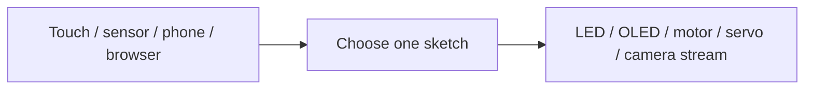

# Embedded Hardware Projects

A collection of Arduino and ESP32 sketches for touch sensors, OLEDs, motors, cameras and browser controls. Each folder is a separate experiment; there is no single application to upload or shared dependency lockfile.

## Sketch index

The descriptions below follow the committed source. Board wiring, library compatibility and physical behavior still need checking for your own build.

| Sketch | Exercise | Main requirements / notes |
| --- | --- | --- |
| [Touch sensor interface](ARDUINO%20PROJECTS/Touch%20sensor%20interface/Touch_sensor.ino) | Digital touch input and LED feedback | Built-in Arduino APIs; touch D2, LED D13 |
| [GALIJ_OLED](ARDUINO%20PROJECTS/GALIJ_OLED/GALIJ_OLED.ino) | OLED animation and touch interaction | Wire, Adafruit GFX / SSD1306 |
| [OLED_TOUCH](ARDUINO%20PROJECTS/OLED_TOUCH/OLED_TOUCH.ino) | Touch-selected OLED animation | Wire, Adafruit GFX / SSD1306 |
| [SdCard_demo](ARDUINO%20PROJECTS/SdCard_demo/SdCard_demo.ino) | SD text-file read/write exercise | SD, SPI; source credits educ8s.tv |
| [Meme_voice_playback](ARDUINO%20PROJECTS/Meme_voice_playback/Meme_voice_playback.ino) | Sensor-triggered ISD1820 playback | Flame input D11, playback trigger D12 |
| [L298N_MODULE_CAR_TEST](ARDUINO%20PROJECTS/L298N_MODULE_CAR_TEST/L298N_MODULE_CAR_TEST.ino) | L298N motor direction / speed test | Check enable and motor pin definitions |
| [2DC_L293D](ARDUINO%20PROJECTS/CAR_TEST/2DC_L293D/2DC_L293D.ino) | Two-motor L293D direction test | D2–D5 motor control |
| [4DC_L293D](ARDUINO%20PROJECTS/CAR_TEST/4DC_L293D/4DC_L293D.ino) | Four-motor direction test | D2–D9 motor control |
| [BT_CAR](ARDUINO%20PROJECTS/BT_CAR/BT_CAR.ino) | HC-05 Bluetooth car commands | SoftwareSerial; includes a commented diagonal-control variant |
| [AIOR_APK_TEST](ARDUINO%20PROJECTS/AIOR_APK_TEST/AIOR_APK_TEST.ino) | App byte-command and motor test | SoftwareSerial; 9600 baud |
| [drone_motor_test](ARDUINO%20PROJECTS/drone_motor_test/drone_motor_test.ino) | Potentiometer-to-ESC throttle exercise | Servo library; A0 potentiometer, D6 signal |
| [ESP32_OLED_TOUCH](ESP32%20PROJECTS/ESP32_OLED_TOUCH/ESP32_OLED_TOUCH.ino) | ESP32 touch-triggered OLED animation | Wire, Adafruit GFX / SSD1306 |
| [SERVO_WEB](ESP32%20PROJECTS/SERVO_WEB/SERVO_WEB.ino) | Single-servo web control | WiFi, ESP32Servo; signal GPIO13 |
| [Pan_tilt_control](ESP32%20PROJECTS/Pan_tilt_control/Pan_tilt_control.ino) | Two-servo web control | WiFi, ESP32Servo; GPIO13 / GPIO12 |
| [CameraWebServer](ESP32%20PROJECTS/CameraWebServer/CameraWebServer.ino) | Camera web-server example | Keep companion .cpp/.h files; check selected camera model |
| [Rhyx-m21-cam](ESP32%20PROJECTS/Rhyx-m21-cam/Rhyx-m21-cam.ino) | RHYX M21 camera streaming | esp_camera, WiFi, WebServer; companion camera_pins.h |
| [ESP32CAM_CAR](ESP32%20PROJECTS/ESP32CAM_CAR/ESP32CAM_CAR.ino) | Camera car with browser controls | AsyncTCP / ESPAsyncWebServer; schematic included |
| [Pan_Tilt_Camera](ESP32%20PROJECTS/Pan_Tilt_Camera/Pan_Tilt_Camera.ino) | Camera stream plus pan/tilt experiment | AsyncTCP, ESPAsyncWebServer, ESP32Servo; integration caveat below |

The [face-detection folder](ARDUINO%20PROJECTS/Face-Detection-main) contains separate Python camera/Arduino experiments. Its [README](ARDUINO%20PROJECTS/Face-Detection-main/README.md) lists cvzone and pyfirmata; it is not an Arduino sketch.

## Try one experiment

1. Clone this repository and open one `.ino` in Arduino IDE. Keep that sketch's companion headers/source files with it. If the IDE asks to create a matching sketch folder, keep the companion files together there too.
2. Select the actual board and port. For ESP32, install the matching board support and check the camera model, GPIO map and partition settings in the chosen folder.
3. Install only the libraries imported by that sketch. OLED examples use Adafruit GFX and SSD1306 with I²C address `0x3C`; camera and async-network examples have additional dependencies listed above. Their API versions are not pinned.
4. Compare every pin definition with your wiring. Configure your own Wi-Fi details locally for network examples; do not commit real credentials. Station-mode examples join a router, while AP examples create their own network.
5. Compile first, then upload and use the sketch's configured serial baud rate for diagnostics. Start with [Touch sensor interface](ARDUINO%20PROJECTS/Touch%20sensor%20interface/Touch_sensor.ino) if you want the smallest wiring exercise.

## Current limitations

- The sketches are learning snapshots, not a set of newly validated hardware builds. An included ZIP of a library is not a versioned compatibility guarantee.
- `Pan_Tilt_Camera` currently starts synchronous and asynchronous servers on port 80. Resolve that shared-port conflict and its client URLs before treating the combined stream/control experiment as working.
- Motor and ESC tests can actuate hardware immediately. Disconnect propellers for ESC checks, lift car wheels for motor checks, use a suitable external actuator supply and share grounds. GPIO pins are control signals, not motor power supplies.
- The SD demo creates/writes files; use a card whose contents you can replace. Sensor polarity and servo travel limits depend on the actual modules.

For the separate combined robot build, see [All-in-One Arduino Robot](https://github.com/SuhanVerse/All_in_one_Arduino_Robot), which includes its app source, schematic and command table.

## License and credits

See [LICENSE](LICENSE) for the repository's MIT license. Retain upstream notices in copied examples, including the SD tutorial attribution and Espressif camera-source headers. Authorship of every upstream example is not implied by this collection.
